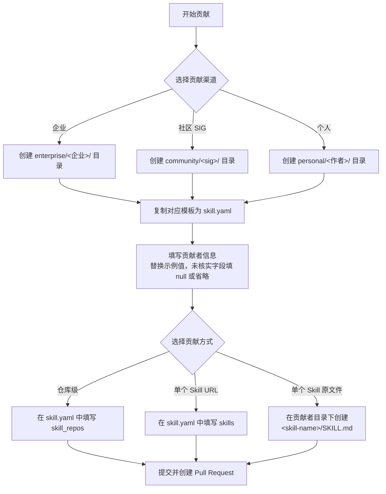

# openEuler-skills

openEuler 生态的 Skill 索引与数据仓库。

本仓库将来自三类来源——企业、openEuler Community SIG、个人作者——的 Agent Skills 聚合到一个结构化的贡献库中。Skill 元数据由 YAML 文件描述，遵循 [`templates/`](templates/) 目录下的模板；扫描器会消费这些 YAML 条目，发现并索引远端仓库中的 `SKILL.md` 文件。

## 仓库结构

```
openEuler-skills/
├── templates/                       # 贡献模板与共享规范
│   ├── enterprise-skill-spec.yaml  # 企业贡献模板
│   ├── community-skill-spec.yaml   # openEuler Community SIG 贡献模板
│   ├── personal-skill-spec.yaml     # 个人作者贡献模板
│   └── skill-spec.yaml              # 共享的 Skill 分类规范
├── enterprise/<企业>/skill.yaml     # 每个企业一个独立目录
├── community/<sig>/skill.yaml       # 每个 SIG 一个独立目录
└── personal/<作者>/skill.yaml       # 每个作者一个独立目录
```

每个 `skill.yaml` 遵循 `templates/` 下对应的模板。

## 贡献渠道

| 渠道 | 适用范围 | 模板 | 必填顶层字段 |
| --- | --- | --- | --- |
| 企业 | 发布 Skill 的公司或组织 | [`enterprise-skill-spec.yaml`](templates/enterprise-skill-spec.yaml) | `organization`、`organization_info` |
| 社区 SIG | openEuler Community 特殊兴趣小组 | [`community-skill-spec.yaml`](templates/community-skill-spec.yaml) | `name` |
| 个人 | 个人开发者或维护者 | [`personal-skill-spec.yaml`](templates/personal-skill-spec.yaml) | `author` |

## Skill 贡献方式

在任何 `skill.yaml` 中，Skill 可以通过以下三种方式贡献（均可选，也可同时使用）：

### 1. 仓库级贡献

贡献一个完整仓库，扫描器会发现仓库内全部符合规范的 `SKILL.md`。

```yaml
skill_repos:        # 企业 / 社区 / 个人
  - url: https://github.com/example/skills
    branch: main    # 可选；不填写时使用仓库默认分支
```

### 2. 单个 Skill 贡献（URL 方式）

贡献某个具体的 `SKILL.md` 文件 URL，不扫描整个仓库。

```yaml
skills:
  - skill_name: skill-name
    skill_url: https://github.com/example/skills/blob/main/skills/skill-name/SKILL.md
    description: 一句话说明该 Skill 的用途
    category: Development and Build   # 可选；取值见下方分类
```

| 字段 | 必填 | 说明 |
| --- | --- | --- |
| `skill_name` | 必填\* | Skill 名称 |
| `skill_url` | 必填\* | `SKILL.md` 文件的完整 URL |
| `description` | 建议 | 一句话说明该 Skill 的用途 |
| `category` | 可选 | Skill 所属分类；取值来自 [`templates/skill-spec.yaml`](templates/skill-spec.yaml) |

\* 当 `skills` 列表非空时必填。

### 3. 单个 Skill 贡献（原文件方式）

直接将 Skill 原文件提交到当前贡献者目录下，扫描器会扫描本仓库内全部 `SKILL.md`。无需在 `skill.yaml` 中登记。

目录结构示例：

```
enterprise/<企业>/
├── skill.yaml                    # 贡献者配置
└── <skill-name>/                 # Skill 目录
    ├── SKILL.md                  # Skill 原文件（必填，文件名大小写敏感）
    ├── references/               # 可选：参考文档
    ├── scripts/                  # 可选：可执行脚本
    └── assets/                   # 可选：其他资源文件

community/<sig>/
├── skill.yaml
└── <skill-name>/
    └── SKILL.md

personal/<作者>/
├── skill.yaml
└── <skill-name>/
    └── SKILL.md
```

`SKILL.md` 的编写规范（frontmatter 字段、必填要求、分类取值等）见 [skill-spec.md](skill-spec.md)。要点：

- `SKILL.md` 由 YAML frontmatter（元数据）+ Markdown 正文（指令）组成。
- frontmatter 中 `name`、`description` 必填（缺失或类型不是 string 会被扫描器跳过）；`category` 建议填写，取值见下方分类。
- 文件名必须是 `SKILL.md`（大小写敏感，`skill.md`、`Skill.md` 均无效）。

### 分类

分类定义在 [`templates/skill-spec.yaml`](templates/skill-spec.yaml) 中：

- Research and Design
- Development and Build
- Engineering and Compilation
- Quality and Validation
- Release and Deployment
- Monitoring and Operations
- Performance Optimization
- Security Hardening
- others

## 约定

- 统一使用 2 个空格缩进，不要使用 Tab。
- 同一个仓库或 Skill URL 不要重复贡献。
- 无法获取或未公开的信息：企业 / 社区填写 `null`，个人直接省略字段；不要自行猜测。
- 空列表使用 `[]`（例如 `skill_repos: []`、`skills: []`）。
- 单个 `SKILL.md` 的 URL 不能填入 `skill_repos`，请使用 `skills` 列表贡献。
- 原文件方式贡献时，Skill 目录需放在对应贡献者目录下（`<渠道>/<标识>/<skill-name>/SKILL.md`）。

## 贡献流程


